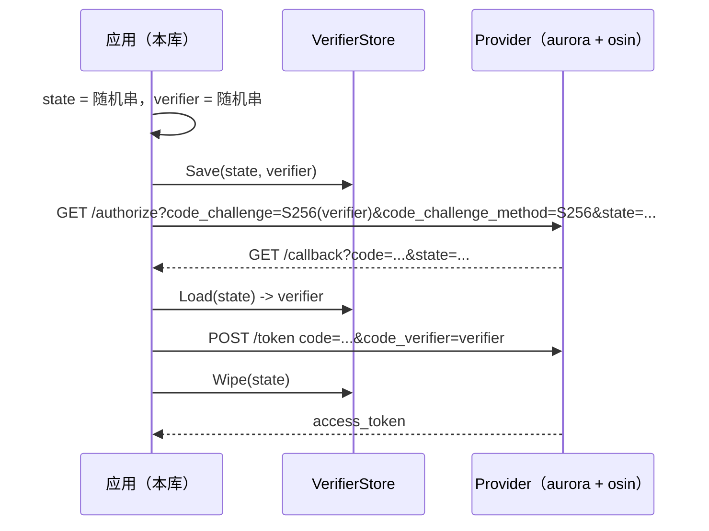

# fix: 客户端补齐 PKCE 以适配 OAuth 2.1 基线

## Summary

让本库在强制 OAuth 2.1 基线的 provider 下重新走通授权码登录：授权入口按 S256 下发 `code_challenge`，
回调兑换时按 state 取回匹配的 `code_verifier` 并一次性消费；verifier 默认内存保存，使用方可替换实现。

---

## Problem Frame

provider（aurora）自 `d1c3ffa2 fix(oauth2): PKCE 挑战随授权码落库并对齐 2.1 基线` 起打开 osin 的
`EnforceOAuth21`，授权码请求缺少 `code_challenge` 时直接在授权端点拒绝：

```
"ErrorStatusCode":400,"URL":"http://localhost:1002/api/m/auth/callback",
"Output":{"error":"invalid_request","error_description":"code_challenge required (rfc7636)"}
```

本库从 v0.2.6 到 v0.2.12 没有任何 PKCE 代码：`LoginStart` / `LoginHandler` 只带 state 与
`redirect_uri`，`AuthCodeCallbackWrap` 兑换时只带 code 与 `redirect_uri`。因此依赖本库的应用在授权入口
就被拒，用户看到的是登录跳转直接失败。

---

## Requirements

- R1. 授权请求携带 `code_challenge` 与 `code_challenge_method=S256`
- R2. 令牌兑换携带与该次授权请求匹配的 `code_verifier`
- R3. verifier 与 state 绑定保存，兑换成功后立即清除；兑换失败不消费，可重试
- R4. verifier 存储可替换：默认内存实现，注册方式与现有 `StateStore` 同形
- R5. 表单（AJAX）分支返回 challenge 字段，前端可原样转发给 provider 的授权端点
- R6. 行为有测试覆盖：存储单测、授权参数断言、授权到兑换的端到端链路、失败路径
- R7. 不改 provider（aurora / osin）侧，也不改登录以外的既有行为

---

## Scope Boundaries

- 不改 provider：`EnforceOAuth21` 与 osin 依赖版本保持现状
- 不实现 `plain` 方法，不加 PKCE 开关，不引入降级路径
- 不改 `StateStore` 接口与默认 cookie state 行为（aurora 已注册的 state 存储无需改动）
- 不迁移依赖本库的应用，版本升级由各应用自行进行
- 不为 device flow、刷新令牌等其它流程实现 PKCE

### Deferred to Follow-Up Work

- aurora 侧实现共享的 `VerifierStore`（redis）：解决多实例与进程重启场景，在 aurora 仓库单独处理
- 各应用升级本库版本；使用表单分支的应用需同步前端转发 challenge 参数

---

## Context & Research

### Relevant Code and Patterns

- `oauth2.go` — `confSgt()` 单例构造 `oauth2.Config`；`LoginStart` 生成 state 并返回 `AuthCodeURL`；
  `LoginHandler` 的 AJAX 分支返回 `AuthFormData`
- `middleware.go` — `AuthCodeCallbackWrap` 校验 state 后调用 `Exchange`；`CodeCallback.Handler` 在登录成功后
  清除 state
- `state.go` — `StateStore` 接口、`RegisterStateStore`、默认 cookie 实现，是本次 `VerifierStore` 的形状参照
- `golang.org/x/oauth2 v0.36.0` 已内置 `GenerateVerifier` / `S256ChallengeOption` / `VerifierOption` /
  `S256ChallengeFromVerifier`

### Institutional Learnings

- 仓库尚无 `docs/solutions/`，无历史经验条目可引用

### External References

- RFC 7636 §4.2 / §4.3：能力允许时客户端必须使用 `S256`；`code_challenge_method` 缺省按 `plain` 处理
- RFC 9700 §2.1.1：推荐使用不暴露 verifier 的变换方法，目前只有 `S256`
- provider 侧证据：aurora `pkg/web/oauth/server.go` 的 `EnforceOAuth21: true`；osin `authorize.go` 的
  `code_challenge required (rfc7636)` 与 `access.go` 的 verifier 比对

---

## Key Technical Decisions

- **变换方法固定 S256**：`plain` 的 challenge 与 verifier 相等，会随授权 URL 暴露在浏览器历史、Referer 与
  provider 日志里，等于没有防护；且 `code_challenge_method` 缺省即 `plain`，必须显式声明 S256。依赖库只
  提供 S256 辅助函数，两端口径一致。
- **verifier 默认内存保存、允许替换**：授权与兑换发生在同一进程内时内存实现最简单，也与本库默认的
  cookie state 部署假设一致（同属单实例语义）；多实例或进程易重启的部署注册共享实现（aurora 用 redis）。
  接口方法集合与 `StateStore` 同形，使用方无需学习新模型。
- **verifier 以 state 为键、兑换成功后消费**：state 是本次登录的唯一定位符；成功后立即 `Wipe` 使其单次有效，
  失败保留以便重试（刷新页面重试回调不会因 verifier 被提前消费而失败）。
- **不加环境开关**：provider 已强制 2.1 基线，授权请求带 challenge 后服务端即绑定该次授权码，客户端必须回传
  verifier；标准实现会忽略或按 PKCE 处理这两个参数，保留开关只会制造一条长期无人验证的分支。
- **表单分支返回 challenge 字段而非整条 URL**：保持 `AuthFormData` 现有形状，前端继续按既有方式构造并提交
  授权请求，只多两个参数。

---

## Open Questions

### Resolved During Planning

- verifier 存放方式：默认内存实现，允许使用方注册替换（用户确认）
- 变换方法：固定 S256
- 消费时机：令牌兑换成功之后
- 是否提供开关：不提供

### Deferred to Implementation

- 内存实现的 TTL 取值：与 provider 的授权码有效期对齐（aurora 侧为 10 分钟），实现时确认最终常量
- 接口方法命名与文件划分：是否把存储实现单独成文件，实现时按仓库现有习惯落定
- 测试如何绕开 `confSgt()` 的 `sync.Once` 单例：`t.Setenv` 先于首次调用，或把授权参数构造抽成纯函数

---

## High-Level Technical Design

> *This illustrates the intended approach and is directional guidance for review, not implementation specification. The implementing agent should treat it as context, not code to reproduce.*



---

## Implementation Units

### U1. verifier 存储抽象与默认内存实现

**Goal:** 提供按 state 存取 PKCE verifier 的存储抽象与默认可替换实现

**Requirements:** R3, R4

**Dependencies:** None

**Files:**
- Create: `verifier.go`
- Test: `verifier_test.go`

**Approach:**
- 形状对齐 `state.go`：导出存储接口（保存 / 读取 / 清除三个动作）、注册函数、包级默认实例
- 默认实现用互斥锁保护的 map，值为 verifier 与过期时间；读取命中且未过期才返回内容，未命中返回空串而不返回错误
- 过期处理采用惰性清理：读取时判定过期，写入时顺带清理，不引入后台 goroutine
- 生存期作为实现内部字段，便于测试用短生存期构造，生产默认与 provider 授权码有效期对齐
- 保存动作返回错误，由调用方记录日志，不静默丢弃——否则失败会推迟到回调阶段才以「verifier 缺失」暴露

**Patterns to follow:**
- `state.go` 的 `StateStore` / `RegisterStateStore` / 默认实例组织方式

**Test scenarios:**
- Happy path: 保存后按同一 state 读取，得到同一个 verifier
- Edge case: 读取未保存的 state 返回空串；清除后再读取返回空串
- Edge case: 超过生存期的条目读取返回空串，且写入触发的清理会移除过期条目
- Edge case: 并发保存、读取、清除同一批 state（`-race` 下运行）结果一致且无 panic
- Error path: 自定义实现返回保存错误时，调用方记录日志并在回调阶段以明确的 verifier 缺失错误结束

**Verification:**
- 新文件用例通过，含 race 检测；接口与注册函数可被外部包引用

---

### U2. 授权入口下发 S256 challenge

**Goal:** 登录入口生成 verifier 并保存，把 S256 challenge 放进授权 URL；表单分支返回 challenge 字段

**Requirements:** R1, R3, R5

**Dependencies:** U1

**Files:**
- Modify: `oauth2.go`
- Test: `oauth2_test.go`

**Approach:**
- `LoginStart`：生成 state 后生成 verifier，保存后把 challenge 选项与既有 `redirect_uri` 选项一起传给
  `AuthCodeURL`
- `LoginHandler` 的表单分支：同样保存 verifier，`AuthFormData` 增加 challenge 与 challenge method 两个
  字段，取值用同一次生成的 verifier 推导，与后续兑换使用的 verifier 必须一致
- 保存失败时记录日志（携带 state），不阻断跳转——授权仍可继续，回调阶段会以明确错误终止
- challenge 的计算交给依赖库的 S256 辅助函数，不自行实现哈希
- 授权选项的构造抽成可直接调用的纯函数，避免单测受 `confSgt()` 单例初始化顺序影响

**Patterns to follow:**
- `oauth2.go` 现有 `getAuthCodeOption` / `getRedirectURI` 的选项构造方式
- `AuthFormData` 现有字段与 JSON 标签风格

**Test scenarios:**
- Happy path: 返回的授权 URL 含 `code_challenge`、`code_challenge_method=S256`，且 `state` 与存储中的键一致
- Happy path: URL 中的 challenge 等于以存储中 verifier 计算的 S256 值，且与 verifier 本身不相等
- Edge case: `RedirectURL` 为相对路径时，URL 同时含按请求 Host 推导出的绝对 `redirect_uri`，保持现有行为
- Edge case: 表单分支返回的数据含 state、client_id、redirect_uri，且 challenge 与存储中 verifier 匹配
- Integration: 连续两次登录入口调用生成不同 state 与不同 verifier，两次记录互不覆盖

**Verification:**
- 两个入口产出的参数都满足 provider 的 2.1 授权校验（challenge 必需、方法为 S256）

---

### U3. 回调兑换携带 verifier 并消费

**Goal:** 回调按 state 取回 verifier 交给令牌兑换，成功后清除

**Requirements:** R2, R3

**Dependencies:** U1, U2

**Files:**
- Modify: `middleware.go`
- Test: `middleware_test.go`

**Approach:**
- `AuthCodeCallbackWrap`：state 校验通过后读取 verifier；读不到时直接以 400 结束并写明原因，不发起令牌请求
  （缺少 verifier 时服务端必然拒绝，本地先失败更利于定位）
- 读取成功后把 verifier 选项加入 `Exchange`，与既有 `redirect_uri` 选项并存
- 兑换成功后立即清除该 state 的 verifier；兑换失败保留，允许重试
- `CodeCallback.Handler` 中现有的 state 清除逻辑保持不变

**Execution note:** 先写假 provider 的端到端用例（授权 URL → 回调 → 令牌请求），再补边界用例

**Patterns to follow:**
- `middleware.go` 现有 `AuthCodeCallbackWrap` 的 state 校验与错误返回方式
- `state.go` 默认实现的中文注释与错误信息风格

**Test scenarios:**
- Happy path: 假 provider 记录令牌请求体，断言含 `code_verifier` 且其 S256 值等于授权请求中的 challenge，兑换成功后进入后续 handler
- Happy path: 兑换成功后 verifier 已被清除——以同一 state 再次回调得到 400
- Error path: state 校验失败时返回 400，且未向令牌端点发起请求
- Error path: state 合法但存储中没有 verifier（进程重启或多实例）时返回 400，错误信息指明 verifier 缺失
- Error path: verifier 超过生存期时返回 400
- Error path: 自定义存储返回空串时按缺失 verifier 处理，返回 400 且不发起令牌请求
- Error path: 令牌端点返回错误时不消费 verifier，同一 state 重试仍能带上 verifier 发起请求
- Integration: 用登录入口产出的真实授权 URL 驱动整条链路，验证 challenge 与 verifier 配对

**Verification:**
- 完整链路中令牌请求携带匹配的 verifier；失败路径都有明确的 400 与日志，不出现静默跳过

---

### U4. 使用说明与升级提示

**Goal:** 文档说明 PKCE 行为、可替换存储、表单分支前端契约与多实例注意事项

**Requirements:** R4, R5, R7

**Dependencies:** U1, U2, U3

**Files:**
- Modify: `README.md`

**Approach:**
- 特性列表补 PKCE；说明方法固定 S256、无开关
- 补 verifier 存储的注册示例与多实例部署要求（注册共享实现）
- 表单分支说明前端需原样回传 challenge 与 challenge method 两个参数

**Test expectation:** none -- 仅文档改动

**Verification:**
- README 描述与实现对得上：方法固定 S256、默认内存存储、可注册替换、无开关

---

## System-Wide Impact

- **Interaction graph:** `LoginStart` / `LoginHandler`（表单分支）/ `AuthCodeCallbackWrap` /
  `CodeCallback.Handler`，以及注册过 `RegisterStateStore` 的应用（aurora `pkg/web/api_a1`）
- **Error propagation:** 本地缺 verifier 或 state 不匹配返回 400 并写日志；verifier 不匹配由 provider 以
  `invalid_grant` 返回，两种失败不会互相掩盖
- **State lifecycle risks:** 未完成的登录在内存中留下条目，靠生存期兜底清理；兑换成功即消费，避免重放
- **API surface parity:** `AuthFormData` 新增字段为加法；新增导出的存储接口与注册函数；`StateStore` 与
  `IClient` 不变，使用方现有代码不必修改
- **Integration coverage:** 与真实 provider 的兼容性需在应用侧联调（例如 aurora 的 `/api/m` 与应用自己的
  回调路由）
- **Unchanged invariants:** 默认 cookie state、`Signin` / `Signout`、`Middleware`、令牌刷新与
  `RequestInfo*` 行为均不变

---

## Risks & Dependencies

| Risk | Mitigation |
|------|------------|
| 默认内存实现在多实例或进程重启后丢失 verifier，登录在回调阶段失败 | 文档明确要求注册共享实现；单实例部署不受影响；aurora 侧的 redis 实现列入后续工作 |
| 使用表单分支的应用未同步前端参数，登录继续失败 | README 显著提示；challenge 与 state 一同返回，前端按原样转发即可 |
| state 与 verifier 错配（并发登录、多标签页） | 存储按 state 分键，不共享单值槽位；state 校验在读取 verifier 之前完成 |
| 兑换成功后 verifier 未清除导致可重放 | 消费点唯一（兑换成功后立即清除），并有重复回调用例覆盖 |
| verifier 保存失败（内存受限或自定义存储异常） | 保存返回错误并由调用方记录日志；回调阶段以明确的 verifier 缺失错误结束，不静默继续 |
| 老 provider 对两个新参数的处理方式不同 | 已知 provider 均为 osin/aurora；标准实现忽略或按 PKCE 处理，不保留降级分支 |

---

## Documentation / Operational Notes

- 发布下一个补丁版本，依赖方升级依赖即可生效，无需新增配置
- 应用升级后关注两类回归：本地回调地址与生产域名都要与注册地址精确匹配（2.1 基线为精确匹配）；多实例部署
  必须先注册共享 verifier 存储

---

## Sources & References

- Related code: `oauth2.go`, `middleware.go`, `state.go`, `README.md`
- Provider evidence: aurora `d1c3ffa2`（`pkg/web/oauth/server.go` 打开 `EnforceOAuth21`）与 osin
  `authorize.go` / `access.go` / `config.go`
- External docs: RFC 7636（PKCE）、RFC 9700 §2.1.1（OAuth 2.0 安全最佳实践）
